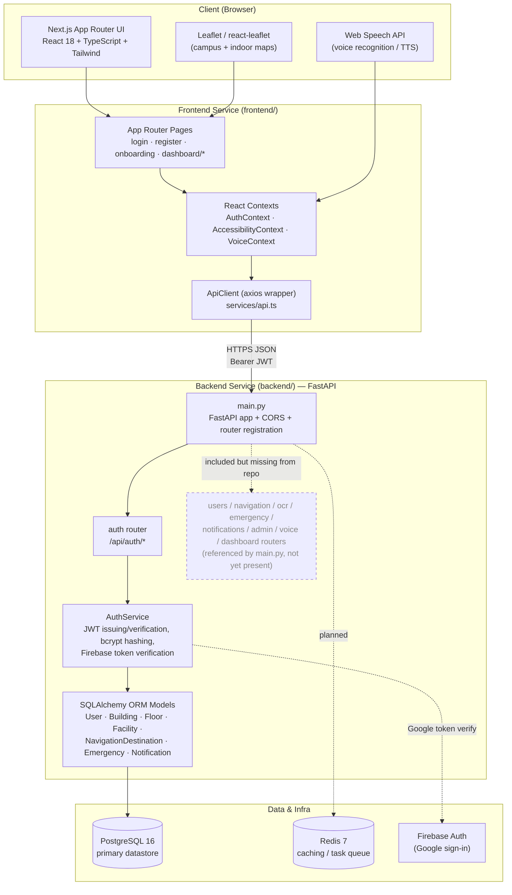
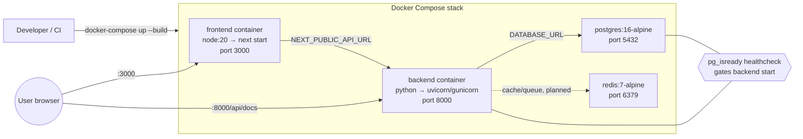
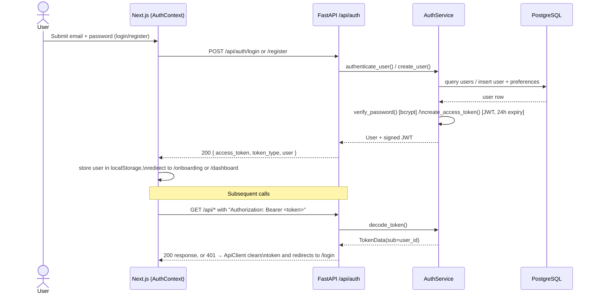
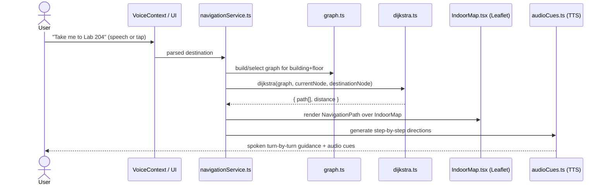
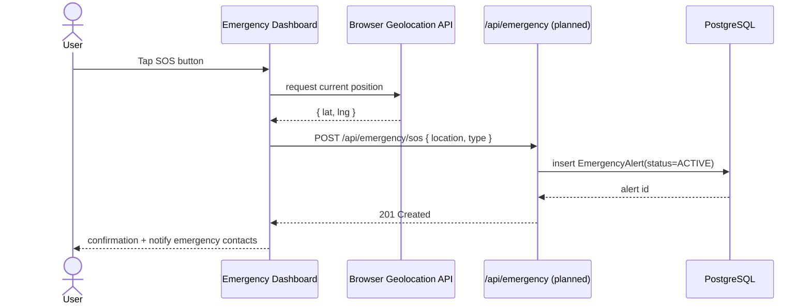
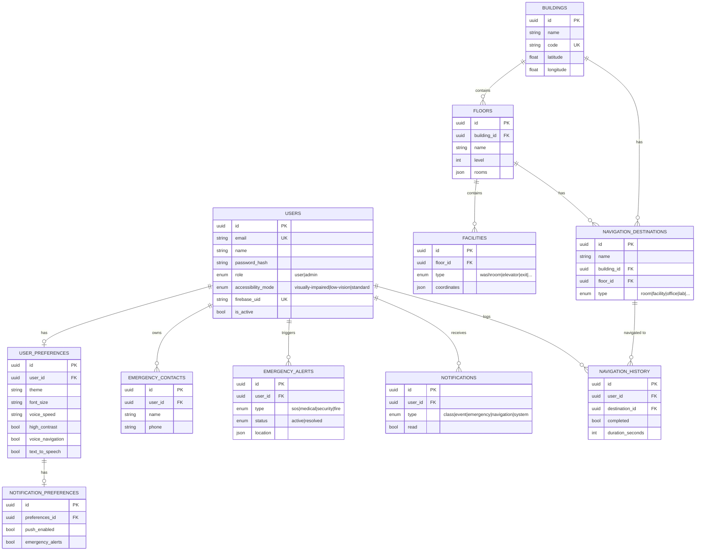
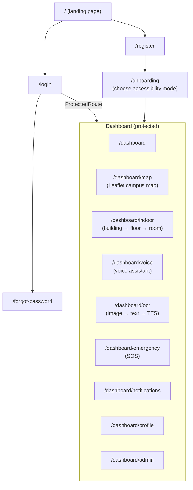

# VisionPath AI — Architecture & Workflow

This document describes how the system is put together: the high-level architecture, the main
request/data flows, the database schema, and the technologies behind each layer. It complements
the feature overview in the root [README.md](../README.md).

> **Status note:** the codebase is a work in progress. Several pieces described in the README and
> wired into `backend/main.py` are not yet implemented in this checkout — see
> [Implementation Status](#implementation-status) at the end of this document for exactly what
> exists today versus what is scaffolded/planned.

---

## 1. System Architecture

**Deployment topology** (`docker-compose.yml`):

In production the README documents **Vercel** for the frontend and **Railway** for the backend,
with the same Docker images used for local Compose.

---

## 2. Authentication Flow

The backend implements a classic JWT flow (`backend/api/routers/auth.py` +
`backend/services/auth_service.py`), but **the frontend currently talks to a local mock**
(`frontend/src/services/auth.ts` fakes the network call and fabricates a `User` from
`localStorage`) rather than the real `/api/auth/*` endpoints. The sequence below shows the
backend-side flow as implemented, which is what the frontend needs to be pointed at to go live.

**Google login** follows the same shape but swaps `authenticate_user` for
`authenticate_with_google`, which verifies a Firebase ID token via `firebase_admin` and
upserts a `User` row keyed on `firebase_uid`.

---

## 3. Indoor Navigation Flow

Pathfinding runs **client-side**: the frontend builds a weighted graph of the selected floor
(`navigation/graph.ts`) and solves it with a textbook Dijkstra implementation
(`navigation/dijkstra.ts`), then narrates the path with turn-by-turn audio cues.

Building/floor/room *data* (used to seed the graph) is modeled on the backend
(`Building` → `Floor` → `Facility` / `NavigationDestination`), but the navigation API router that
would serve this data to the frontend is not present yet — today `indoorMapData.ts` supplies
static/mock map data to the client.

---

## 4. Emergency SOS Flow

`EmergencyContact` and `EmergencyAlert` ORM models exist (`backend/models/emergency.py`); the
`emergency` router that would expose this flow over HTTP is referenced by `main.py` but not yet
implemented.

---

## 5. Data Model (PostgreSQL / SQLAlchemy)

All primary keys are `UUID` (generated client-side via `uuid.uuid4()`); schema creation is done
via `Base.metadata.create_all()` on startup (`backend/main.py:18`) rather than Alembic
migrations, even though `alembic` is a declared dependency.

---

## 6. Frontend Route Map

`DashboardLayout` wraps all `/dashboard/*` routes with `ProtectedRoute` (redirects unauthenticated
users to `/login`), the sidebar, the `VoiceFloatingButton`, and the accessibility
announcer/skip-link components.

---

## 7. Tech Stack

### Frontend (`frontend/`)
| Concern | Technology |
|---|---|
| Framework | Next.js 14 (App Router), React 18, TypeScript |
| Styling | Tailwind CSS, `tailwind-merge`, `clsx` |
| Animation | Framer Motion |
| Server state | TanStack React Query, Axios |
| Forms & validation | React Hook Form, Zod |
| UI primitives | Radix UI (dialog, dropdown, tabs, tooltip, popover, switch, slider), Lucide icons |
| Maps | Leaflet, react-leaflet (OpenStreetMap tiles) |
| Charts | Recharts (admin/dashboard analytics) |
| Auth (client) | Firebase JS SDK (Google sign-in), custom `AuthContext` |
| Voice | Web Speech API (`SpeechRecognition` / `SpeechSynthesis`) via `VoiceContext` |
| Theming | `next-themes` (light/dark/system) |

### Backend (`backend/`)
| Concern | Technology |
|---|---|
| Framework | FastAPI 0.111, Uvicorn (dev) / Gunicorn (prod) |
| ORM / DB driver | SQLAlchemy 2.0, `psycopg2-binary` |
| Migrations (declared, unused) | Alembic |
| Auth | `python-jose` (JWT), `passlib[bcrypt]` (password hashing), `firebase-admin` (Google token verification) |
| Validation | Pydantic 2 / `pydantic-settings` |
| OCR | `pytesseract`, `opencv-python`, `Pillow`, `numpy` |
| Background/async work (declared, unused) | Celery + Redis |
| HTTP client | `httpx` |

### Data & Infrastructure
| Concern | Technology |
|---|---|
| Primary database | PostgreSQL 16 |
| Cache / queue | Redis 7 |
| Containerization | Docker, Docker Compose |
| Frontend hosting | Vercel |
| Backend hosting | Railway |
| API docs | Swagger UI (`/api/docs`), ReDoc (`/api/redoc`) — auto-generated by FastAPI |

---

## 8. Implementation Status

What's actually present in this checkout vs. what the README/`main.py` describe:

| Area | Status |
|---|---|
| FastAPI app shell, CORS, health check | ✅ Implemented (`backend/main.py`) |
| Auth router (`register`, `login`, `google`, `forgot/reset-password`, `me`) | ✅ Implemented (`backend/api/routers/auth.py`) |
| `AuthService` (JWT, bcrypt, Firebase) | ✅ Implemented |
| ORM models (User, Navigation, Emergency, Notification) | ✅ Implemented (`backend/models/`) |
| `users`, `navigation`, `ocr`, `emergency`, `notifications`, `admin`, `voice`, `dashboard` routers | ⚠️ Imported by `main.py` but the modules do not exist in `backend/api/routers/` — **the backend will fail to start until these are added or the imports are removed** |
| Alembic migrations | ⚠️ Dependency declared, no `alembic.ini`/`migrations/` found; schema is created via `create_all()` |
| Celery/Redis task queue | ⚠️ Dependency declared, no Celery app/tasks found |
| Frontend pages for all dashboard features | ✅ Implemented (UI only, see route map above) |
| Frontend ↔ backend auth wiring | ⚠️ `services/auth.ts` is a local mock (`localStorage` + fake delay); not yet calling `/api/auth/*` |
| Frontend navigation data | ⚠️ Uses static `indoorMapData.ts`; not yet fetched from a `navigation` API |

This table is the most useful starting point for prioritizing remaining work: the single
highest-impact fix is implementing (or stubbing) the eight missing routers so `uvicorn main:app`
can boot at all.
